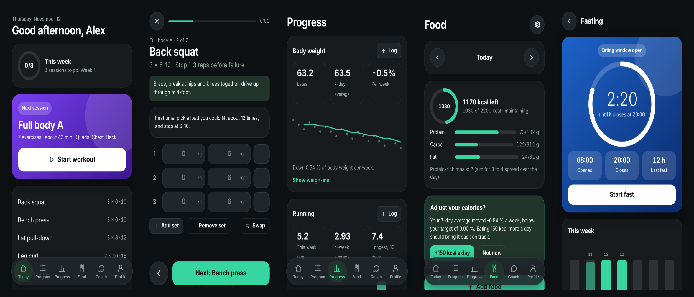

# Banzir

Your own workout app, on your own URL.

Fork this repo, deploy it to Vercel, open it on your phone and the onboarding
builds a training plan for your goal: muscle, strength, calisthenics skills,
running, fat loss, general fitness or sport support. Everything is stored on
your device. No account, no database, nothing to configure.



## What it does

- **Plans for any goal and level.** 35 ready-made plans, from complete
  beginner to advanced, fitted to your equipment, schedule and session length.
  Calisthenics skills (handstand, planche, front lever, muscle-up), running
  from couch to marathon, sport support (football, tennis, boxing and more).
- **Guided workouts.** One set at a time, rest and interval timers, last-time
  values and suggestions for the next load or progression step.
- **A plan builder.** Change any day, exercise, set, rep or rest, or build
  your own program from scratch.
- **Optional modules.** Food and calories, body weight, running (with GPX
  import and heart-rate zones) and fasting. Turn on only what you want.
- **Optional AI coach.** Bring your own key from Claude, OpenAI, Gemini,
  OpenRouter, Groq, Mistral or a local model. It reads your plan and log,
  keeps notes you can see and delete, and proposes changes you accept or
  dismiss.
- **Yours to style.** Ten themes, any accent colour, kg or lb, km or mi.
- **Works offline** once added to your home screen.

Every training and nutrition number in the app traces to a source in
[`docs/science`](docs/science), with a note on how well it was checked.

## Get your own copy

[](https://vercel.com/new/clone?repository-url=https%3A%2F%2Fgithub.com%2FS2K7x%2FBanzir)

1. Click the button. Vercel copies the repo to your GitHub account and deploys it.
2. Open your new address on your phone.
3. Add it to your home screen (the app explains how). This keeps your data safe and makes it work offline.

To get updates later, open your copy on GitHub and click "Sync fork". Vercel
redeploys, and the app offers to update itself. See
[`CHANGELOG.md`](CHANGELOG.md) for what changed.

Banzir also runs on any static host (Netlify, Cloudflare Pages, GitHub
Pages): build with `npm run build` and serve `dist/`. Only the optional AI
relay for OpenAI, Gemini, Groq and Mistral needs Vercel; Claude and
OpenRouter work everywhere.

## Your data and privacy

Everything you log stays on your device, in the browser's storage. There is
no account and nothing is stored on a server. The app only goes online to
load and update itself, when you use the AI coach (your messages go to the
provider you chose, with your own key), or when you search for a food (the
search words go to Open Food Facts).

Save a backup from Profile now and then: it is one file you can restore on
any device. Your AI key is never put in a backup.

Banzir gives general training guidance. It is not medical advice.

## Develop

```bash
npm install
```

```bash
npm run dev
```

```bash
npm test
```

```bash
npm run build
```

```bash
npm run e2e
```

`npm run e2e` runs the browser tests in [`e2e/`](e2e) against a production
build at phone size. The accessibility checks (`npm run a11y`,
`npm run contrast`) and the rest of the commands are listed in
[`docs/product/architecture.md`](docs/product/architecture.md#commands).

## Documentation

- Project context and decisions: [`CLAUDE.md`](CLAUDE.md)
- Product: [`docs/product`](docs/product)
- Program schema and templates: [`docs/programs`](docs/programs)
- Training and nutrition evidence: [`docs/science`](docs/science)
- Research log: [`docs/research-log.md`](docs/research-log.md)

Licence: MIT.
